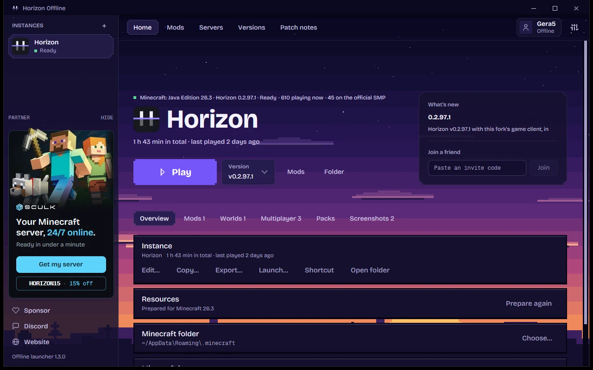

<h1 align="center">Horizon Offline Launcher</h1>

<p align="center">
  <b>A launcher for <a href="https://github.com/horizon-rust/horizon">Horizon</a> (Minecraft: Java Edition 26.3 rewritten in Rust) that plays without a Microsoft account and lets you pick your own jar.</b>
</p>

<p align="center">
  <a href="https://github.com/gerdaroot/Horizon-Offline-Launcher/releases/latest/download/Horizon-Offline-Launcher-Setup.exe"><b>Download for Windows</b></a> ·
  <a href="#install">Install</a> ·
  <a href="#first-run">First run</a> ·
  <a href="#faq">FAQ</a> ·
  <a href="#русский"><b>Русский</b></a>
</p>

<p align="center">
  <a href="https://github.com/gerdaroot/Horizon-Offline-Launcher/actions/workflows/launcher.yml"></a>
  
  
  <a href="LICENSE"></a>
</p>

<p align="center">
  
</p>

## What it is

[Horizon](https://github.com/horizon-rust/horizon) is Minecraft: Java Edition 26.3 rewritten in Rust: its own renderer, world, mobs and redstone, compatible with vanilla worlds. This repository is a fork of it where:

- **No account is required.** Play starts the game offline under your own name, and everything works without one: mods, resource packs, shaders, instances, servers, friends. These builds have no Microsoft sign-in at all.
- **Your own skin.** Pick a skin PNG (classic or slim arms) in Settings → Account: you wear it in single player and on servers that send no skin of their own.
- **You can pick your own jar.** "Choose jar…" takes a `26.3.jar` from anywhere: TLauncher, your Downloads folder, a USB stick. Without a choice, the launcher finds it by itself in the folders of the official launcher, TLauncher, Prism, MultiMC, Modrinth, ATLauncher and GDLauncher.
- **Updates come from this repository only.** The launcher and the game update themselves from its releases, signed with its own key, so an upstream update can't bring the account requirement back.
- **Fixes in the game client**, such as joining servers whose proxy pads packet lengths (FunTime).
- **A real Windows installer**, or one command on any system, with desktop and Start menu shortcuts.

Everything else works as in Horizon: mods, resource packs, instances, servers, playing with friends by invite code.

> Unofficial. Not affiliated with Mojang, Microsoft or the Horizon authors. No Minecraft files are included: the game needs your own copy of Minecraft: Java Edition 26.3.

## Install

<p align="center">
  <a href="https://github.com/gerdaroot/Horizon-Offline-Launcher/releases/latest/download/Horizon-Offline-Launcher-Setup.exe"></a>
</p>

### Windows

1. **[Download `Horizon-Offline-Launcher-Setup.exe`](https://github.com/gerdaroot/Horizon-Offline-Launcher/releases/latest/download/Horizon-Offline-Launcher-Setup.exe)**.
2. **Run it.** If Windows says "Windows protected your PC", click **More info → Run anyway** (the file just isn't code-signed).
3. **Install → Finish.** The launcher opens by itself; its shortcuts are in the Start menu and, if you ticked it, on the desktop.

No administrator rights needed: it installs for your user only, in `%LOCALAPPDATA%\Programs\HorizonOfflineLauncher`. To remove it: Settings → Apps → Horizon Offline Launcher → Uninstall. Your worlds and settings stay.

<details>
<summary>Without the installer: one command in PowerShell</summary>

Win+X → Terminal, then:

```powershell
irm https://github.com/gerdaroot/Horizon-Offline-Launcher/releases/latest/download/install.ps1 | iex
```

It puts the launcher in the same place, with the same shortcuts.
</details>

### Linux and macOS

```sh
curl -fsSL https://github.com/gerdaroot/Horizon-Offline-Launcher/releases/latest/download/install.sh | sh
```

Then start it with `horizon-offline-launcher`. On Linux it adds itself to the applications menu.

## First run

1. **Have Minecraft 26.3.** If you don't yet, download and start version **26.3** once in any launcher (official, TLauncher, Prism…).
2. **Open Horizon Offline Launcher.** It downloads the latest Horizon by itself.
3. **Press "Prepare"** on the Resources row. The launcher finds your `26.3.jar` and builds the textures and sounds from it: once, in a few minutes. If it can't find the jar, press **"Choose jar…"** and pick `26.3.jar`; it is usually in `.minecraft\versions\26.3\`.
4. **Press "Play".**

Your offline name is changed with the player button at the top right; its skin in Settings → Account.

## FAQ

**Will a jar of another version (1.21, say) work?** No. Horizon reproduces 26.3 exactly: its data and network protocol are tied to that version. The launcher checks the file's checksum and says so when the jar isn't the right one.

**Preparing asks for Java.** Preparing needs Java 25. The launcher looks for it in other launchers and downloads it when it finds none. If that fails, install [Java 25](https://adoptium.net/temurin/releases/?version=25) and try again.

**How do I play with friends?** Pause → Friends gives an invite code; LAN works too. Any server that lets players without an account in (`online-mode=false`, like FunTime) works; online-mode servers (Hypixel and the like) check every player's Minecraft license with Mojang and don't.

**Do other players see my skin?** Skins between players go through Mojang's servers, which only take a licensed account's. On servers for players without an account, set yours with the server's skin command (SkinsRestorer: `/skin <name or link>`): everyone sees that one. The skin you pick in the launcher is the one you see on yourself where the server gives none. Capes aren't drawn yet.

**Do resource packs work?** Yes, as in Horizon: Options → Resource Packs in the game, or the launcher's resource packs page.

**Where are my worlds?** Where the official Horizon launcher keeps them: both use the same data folder, so worlds, instances and settings are shared.

**How do I update?** The launcher does it by itself: it updates itself and offers new game versions from this repository's releases. Launchers 1.0.x never update themselves: run the installer (or the install command) once more to get one that does. Worlds and settings stay.

## Building from source

Windows (needs [Visual Studio Build Tools](https://visualstudio.microsoft.com/visual-cpp-build-tools/) with "Desktop development with C++"):

```powershell
git clone https://github.com/gerdaroot/Horizon-Offline-Launcher
cd Horizon-Offline-Launcher
powershell -ExecutionPolicy Bypass -File build.ps1
```

`build.ps1` installs Rust when it is missing, finds the Windows SDK's shader compiler `fxc.exe` on any drive, builds the launcher and installs it with shortcuts.

Linux and macOS:

```sh
cd launcher
cargo build --release
./target/release/horizon-launcher
```

Linux needs `libxkbcommon-x11-dev libwayland-dev libx11-xcb-dev libfontconfig-dev libvulkan-dev libasound2-dev` first.

Releases are published by tags, and GitHub Actions builds Windows, Linux and macOS:

- `launcher@1.2.0`: the launcher, with the Windows installer and the install scripts. It becomes the repository's latest release.
- `v0.2.97.1`: the game, Horizon 0.2.97's files with this fork's client. The fourth number is this fork's revision of a Horizon version; `v0.2.98` would be built on Horizon 0.2.98.

Both are signed with the repository's key (the `RELEASE_SIGNING_KEY` secret); launchers refuse anything else.

## How it differs from Horizon

| | Horizon | Horizon Offline Launcher |
|---|---|---|
| Microsoft account | required | not needed |
| Your own skin offline | no | yes, Settings → Account |
| Windows installer | no, a zip | yes, Setup.exe |
| Your own jar file | no, launcher folders only | yes, "Choose jar…" |
| Launcher updates | automatic, from Horizon | automatic, from this repository |
| The game | Horizon releases | Horizon releases with this fork's client |

The launcher's changes: `launcher/src/account.rs` (signing in is no longer required), `launcher/src/sources.rs` (`from_jar`), `launcher/src/main.rs` (the UI), `launcher/src/backend.rs` (releases from this repository). In the game: `crates/horizon-protocol/src/frame.rs` (compressed packets as vanilla reads them), `crates/horizon-client/src/skins.rs` (the offline skin). The installer: `packaging/windows/setup.iss`.

## Credits and license

The game and nearly all of the code are [Horizon](https://github.com/horizon-rust/horizon), by Ludovic Marie and the Horizon contributors. MIT license, see [LICENSE](LICENSE). The game's full documentation: [playhorizon.dev/docs](https://playhorizon.dev/docs/).

---

## Русский

**Horizon Offline Launcher** — лаунчер для [Horizon](https://github.com/horizon-rust/horizon) (Minecraft: Java Edition 26.3, переписанный на Rust) без обязательного аккаунта Microsoft и с выбором своего jar.

<p>
  <a href="https://github.com/gerdaroot/Horizon-Offline-Launcher/releases/latest/download/Horizon-Offline-Launcher-Setup.exe"><b>Скачать для Windows</b></a> ·
  <a href="#установка">Установка</a> ·
  <a href="#первый-запуск">Первый запуск</a> ·
  <a href="#вопросы">Вопросы</a> ·
  <a href="#what-it-is">English</a>
</p>

### Что это

[Horizon](https://github.com/horizon-rust/horizon) — это Minecraft: Java Edition 26.3, заново написанный на Rust: свои рендер, мир, мобы и редстоун, совместимые с ванильными мирами. Этот репозиторий — его форк, в котором:

- **Аккаунт не нужен.** «Играть» запускает игру офлайн под вашим ником, и без аккаунта работает всё: моды, ресурс-паки, шейдеры, сборки, серверы, друзья. Входа через Microsoft в этих сборках нет вообще.
- **Свой скин.** PNG скина (обычные или тонкие руки) выбирается в «Настройки → Аккаунт»: он виден на вас в одиночной игре и на серверах, которые не дают свой.
- **Можно выбрать свой jar.** Кнопка «Выбрать jar…» берёт файл `26.3.jar` откуда угодно: из TLauncher, папки «Загрузки» или с флешки. Без выбора лаунчер сам ищет его в папках официального лаунчера, TLauncher, Prism, MultiMC, Modrinth, ATLauncher и GDLauncher.
- **Обновления только из этого репозитория.** Лаунчер и игра обновляются сами из его релизов, подписанных своим ключом, поэтому официальное обновление не вернёт обязательный вход.
- **Исправления в клиенте игры**, например вход на серверы, чей прокси дополняет длину пакетов (FunTime).
- **Настоящий установщик для Windows** или одна команда на любой системе. Ярлыки на рабочем столе и в меню «Пуск» создаются сами.

Всё остальное — как в Horizon: моды, ресурс-паки, сборки, серверы, игра с друзьями по коду.

> Неофициальный проект, не связан с Mojang, Microsoft и авторами Horizon. Файлов Minecraft здесь нет: игре нужен ваш собственный Minecraft: Java Edition 26.3.

### Установка

<p align="center">
  <a href="https://github.com/gerdaroot/Horizon-Offline-Launcher/releases/latest/download/Horizon-Offline-Launcher-Setup.exe"></a>
</p>

**Windows**

1. **[Скачайте `Horizon-Offline-Launcher-Setup.exe`](https://github.com/gerdaroot/Horizon-Offline-Launcher/releases/latest/download/Horizon-Offline-Launcher-Setup.exe)**.
2. **Запустите его.** Если Windows покажет «Windows защитила ваш компьютер», нажмите **«Подробнее» → «Выполнить в любом случае»** (файл просто не подписан сертификатом).
3. **«Установить» → «Завершить».** Лаунчер откроется сам; ярлыки — в меню «Пуск» и, если отметили галочку, на рабочем столе.

Права администратора не нужны: установка только для вашего пользователя, в `%LOCALAPPDATA%\Programs\HorizonOfflineLauncher`. Удалить: «Параметры» → «Приложения» → Horizon Offline Launcher → «Удалить». Миры и настройки останутся.

<details>
<summary>Без установщика: одна команда в PowerShell</summary>

Win+X → «Терминал», затем:

```powershell
irm https://github.com/gerdaroot/Horizon-Offline-Launcher/releases/latest/download/install.ps1 | iex
```

Лаунчер встанет в то же место, с теми же ярлыками.
</details>

**Linux и macOS:**

```sh
curl -fsSL https://github.com/gerdaroot/Horizon-Offline-Launcher/releases/latest/download/install.sh | sh
```

После установки лаунчер запускается командой `horizon-offline-launcher`. На Linux он сам добавит себя в меню приложений.

### Первый запуск

1. **Нужен Minecraft 26.3.** Если его ещё нет, скачайте и один раз запустите версию **26.3** в любом лаунчере (официальном, TLauncher, Prism и т. д.).
2. **Откройте Horizon Offline Launcher.** Он сам скачает последнюю версию Horizon.
3. **Нажмите «Подготовить»** в строке «Ресурсы». Лаунчер найдёт ваш `26.3.jar` и соберёт из него текстуры и звуки. Это делается один раз и занимает несколько минут. Если jar не нашёлся, нажмите **«Выбрать jar…»** и укажите файл `26.3.jar`; обычно он лежит в `.minecraft\versions\26.3\`.
4. **Нажмите «Играть».**

Ник для офлайн-игры меняется вверху справа, кнопкой с именем игрока, а его скин — в «Настройки → Аккаунт».

### Вопросы

**Подойдёт jar другой версии, например 1.21?** Нет. Horizon воспроизводит именно 26.3, его данные и сетевой протокол привязаны к этой версии. Лаунчер проверяет контрольную сумму файла и, если jar не тот, прямо говорит об этом.

**«Подготовка» просит Java.** Для подготовки нужна Java 25. Лаунчер ищет её у других лаунчеров и, если не находит, скачивает сам. Если не вышло, установите [Java 25](https://adoptium.net/temurin/releases/?version=25) и повторите.

**Как играть с друзьями?** Пауза → «Друзья» даёт код приглашения, LAN тоже работает. Подходит любой сервер, который пускает игроков без аккаунта (`online-mode=false`, как FunTime). Серверы с online-mode (Hypixel и подобные) проверяют лицензию каждого игрока у Mojang и не пустят.

**Видят ли другие мой скин?** Скины между игроками раздают серверы Mojang, а туда загружается только скин лицензии. На серверах для игроков без аккаунта ставьте скин командой сервера (SkinsRestorer: `/skin <ник или ссылка>`) — его увидят все. Скин из лаунчера — тот, что вы видите на себе там, где сервер не дал свой. Плащи пока не рисуются.

**Ресурс-паки работают?** Да, как в Horizon: «Настройки → Пакеты ресурсов» в игре или страница ресурс-паков в лаунчере.

**Где мои миры?** Там же, где у официального лаунчера Horizon: обе программы используют одну папку данных, так что миры, сборки и настройки общие.

**Как обновиться?** Лаунчер делает это сам: обновляется и предлагает новые версии игры из релизов этого репозитория. Лаунчеры 1.0.x сами не обновляются: запустите установщик (или команду установки) ещё раз, чтобы получить тот, что умеет. Миры и настройки останутся на месте.

### Сборка из исходников

Windows (нужны [Visual Studio Build Tools](https://visualstudio.microsoft.com/visual-cpp-build-tools/) с «Разработкой классических приложений на C++»):

```powershell
git clone https://github.com/gerdaroot/Horizon-Offline-Launcher
cd Horizon-Offline-Launcher
powershell -ExecutionPolicy Bypass -File build.ps1
```

`build.ps1` сам поставит Rust, если его нет, найдёт компилятор шейдеров `fxc.exe` из Windows SDK на любом диске, соберёт лаунчер и установит его с ярлыками.

Linux и macOS:

```sh
cd launcher
cargo build --release
./target/release/horizon-launcher
```

На Linux перед сборкой нужны пакеты `libxkbcommon-x11-dev libwayland-dev libx11-xcb-dev libfontconfig-dev libvulkan-dev libasound2-dev`.

Релизы выпускаются тегами, GitHub Actions собирает Windows, Linux и macOS:

- `launcher@1.2.0` — лаунчер, с установщиком для Windows и скриптами установки. Становится последним релизом репозитория.
- `v0.2.97.1` — игра: файлы Horizon 0.2.97 с клиентом этого форка. Четвёртая цифра — своя ревизия форка поверх версии Horizon; `v0.2.98` собиралась бы на Horizon 0.2.98.

Оба подписываются ключом репозитория (секрет `RELEASE_SIGNING_KEY`), всё остальное лаунчеры отвергают.

### Чем отличается от Horizon

| | Horizon | Horizon Offline Launcher |
|---|---|---|
| Аккаунт Microsoft | обязателен | не нужен |
| Свой скин без аккаунта | нет | да, «Настройки → Аккаунт» |
| Установщик для Windows | нет, zip | да, Setup.exe |
| Свой jar-файл | нет, только папки лаунчеров | да, кнопка «Выбрать jar…» |
| Обновление лаунчера | само, из Horizon | само, из этого репозитория |
| Игра | релизы Horizon | релизы Horizon с клиентом этого форка |

Изменения лаунчера: `launcher/src/account.rs` (вход больше не обязателен), `launcher/src/sources.rs` (`from_jar`), `launcher/src/main.rs` (интерфейс), `launcher/src/backend.rs` (релизы из этого репозитория). В игре: `crates/horizon-protocol/src/frame.rs` (сжатые пакеты читаются как в ванилле), `crates/horizon-client/src/skins.rs` (офлайн-скин). Установщик: `packaging/windows/setup.iss`.

### Благодарности и лицензия

Игра и почти весь код — [Horizon](https://github.com/horizon-rust/horizon) от Ludovic Marie и участников проекта. Лицензия MIT, см. [LICENSE](LICENSE). Подробная документация по игре: [playhorizon.dev/docs](https://playhorizon.dev/docs/).
